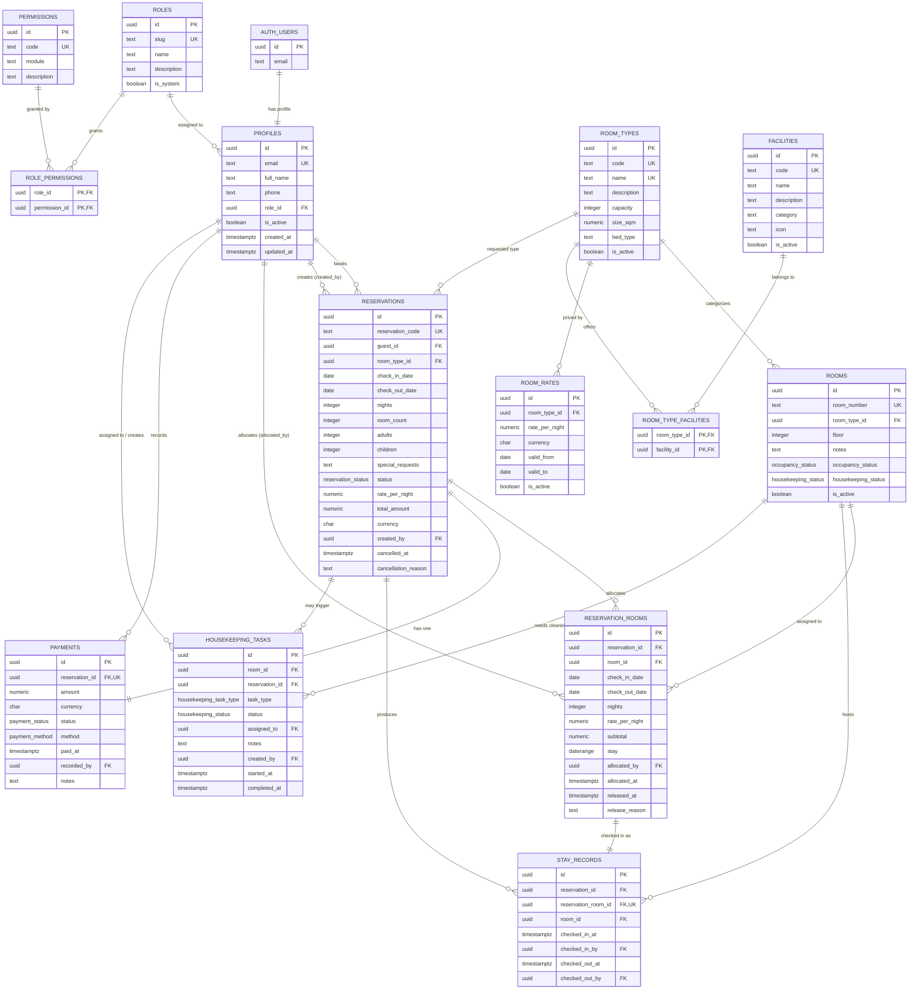
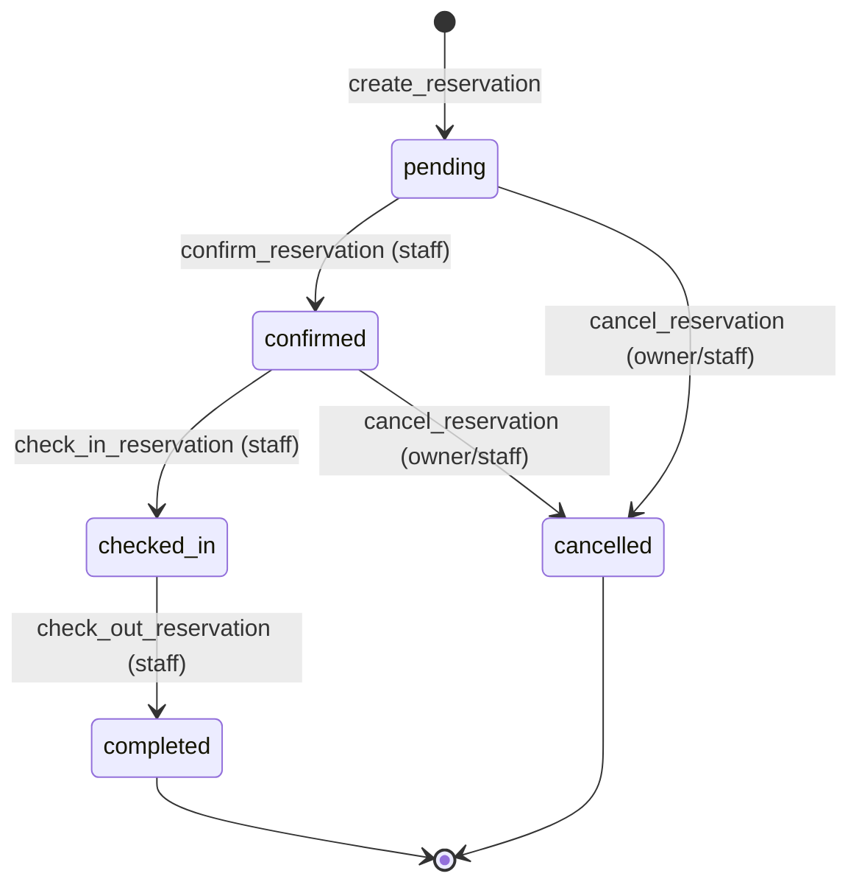

# Database ERD

## Logical relationships

## Cardinalities in words

- One auth user has exactly one `profiles` row.
- One role has many profiles; one profile has exactly one role.
- Roles and permissions are many-to-many through `role_permissions`.
- One room type has many physical rooms and many rate windows.
- A room type has many facilities; a facility can belong to many room types.
- A guest profile can create many reservations.
- One reservation targets exactly one room type and has a `room_count` from 1 to
  10.
- One reservation has zero or more `reservation_rooms` allocations; the number
  of active allocations may not exceed `room_count`.
- One reservation has exactly one payment record in the current business model.
- One active `reservation_rooms` row can produce one `stay_records` row when the
  guest is checked in.
- Housekeeping tasks reference a room; they may also reference the reservation
  that generated the checkout clean.

## Important invariants

1. `reservations.check_out_date > check_in_date`.
2. `reservations.nights = check_out_date - check_in_date`.
3. `reservations.total_amount = rate_per_night * nights * room_count`.
4. Active `reservation_rooms` for the same room cannot overlap
   (`stay && stay` exclusion).
5. `reservation_rooms` copies stay, rate, and subtotal from its reservation.
6. A physical room allocation must match the reservation room type and be active.
7. `payments.amount = reservations.total_amount` and currencies match.
8. A reservation status only moves through
   `pending -> confirmed -> checked_in -> completed`, with cancellation allowed
   from `pending` or `confirmed`.
9. Reservation identity, stay, and pricing fields are immutable to non-admin
   callers after creation.
10. `profiles.role_id` and `profiles.is_active` are not editable by non-admins.

## Deletion behavior

- Deleting an auth user cascades to their profile.
- A role used by profiles cannot be deleted (`on delete restrict`).
- A room type used by rooms or reservations cannot be deleted.
- A physical room used by allocations or stays cannot be deleted.
- Deleting a reservation cascades to allocations, payments, stays, and sets
  `housekeeping_tasks.reservation_id` to null.
- Deleting a room cascades to housekeeping tasks, but allocations/stays restrict
  deletion while they reference the room.

## Enum transition map

